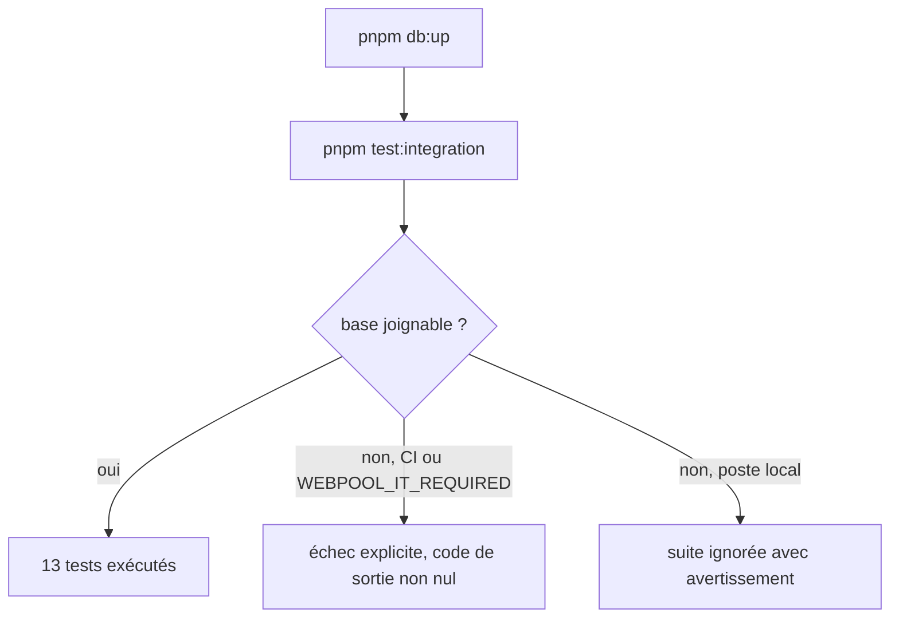
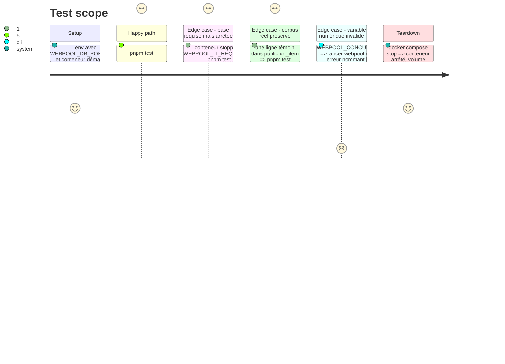

# Instruction: Tests d'intégration contraignants, base locale, CI

## Architecture projection

> Tree of the final files. ✅ create · ✏️ modify · ❌ delete

```txt
.
├── .github/
│   └── workflows/
│       └── ci.yml                    ✅ unitaires + intégration sur service postgres:17, Node 22 et 24
├── docker-compose.yml                ✏️ port publié sur 127.0.0.1
├── package.json                      ✏️ packageManager pnpm@10.5.2 (requis par pnpm/action-setup)
├── src/
│   ├── env.js                        ✅ sans effet de bord sur config : loadDotEnv(), defaultDatabaseUrl(), intEnv()
│   └── config.js                     ✏️ s'appuie sur env.js
├── test/
│   ├── config.test.js                ✅ intEnv et URL par défaut
│   └── integration/
│       ├── helpers.js                ✏️ charge .env, même URL par défaut que config.js, mode requis
│       └── pipeline.test.js          ✏️ échoue au lieu d'ignorer quand la base est requise
└── README.md                         ✏️ section Tests : WEBPOOL_IT_REQUIRED, CI
```

## User Journey



## Test Scope



## Tasks to do

### `1)` Base liée à la boucle locale

> La base n'est plus joignable depuis le réseau local.

1. `docker-compose.yml` : `"127.0.0.1:${WEBPOOL_DB_PORT:-5432}:5432"`.
2. Recréer le conteneur (`docker compose up -d`) et vérifier `docker port webpool-db` → `127.0.0.1:…`.

### `2)` Configuration DB partagée

> CLI et tests calculent la même URL de base.

1. `src/env.js` (nouveau, n'importe rien du projet) : `loadDotEnv()` (`process.loadEnvFile` sur `.env` à la racine, absent toléré, appel unique) et `defaultDatabaseUrl()` construite avec `WEBPOOL_DB_PORT ?? 5432`.
2. `src/config.js` : appelle `loadDotEnv()`, puis `DATABASE_URL ?? defaultDatabaseUrl()`.
3. Ajouter dans `src/env.js` (testable sans charger le singleton) `intEnv(name, fallback, min)` : entier ≥ `min`, sinon `Error` nommant la variable ; `config.js` l'utilise. Minimum 1 pour `WEBPOOL_FETCH_TIMEOUT_MS`, `WEBPOOL_CONCURRENCY`, `WEBPOOL_MAX_BODY_BYTES` ; minimum 0 pour `WEBPOOL_HOST_DELAY_MS`, `WEBPOOL_FETCH_RETRIES`, `WEBPOOL_FETCH_BACKOFF_MS`.

### `3)` Helpers d'intégration

> La suite trouve la base que `.env` décrit, sans jamais toucher au schéma réel.

1. `test/integration/helpers.js` : importer `src/env.js` uniquement, **jamais `src/config.js`** : `setup.js` importe `helpers.js` avant d'affecter `DATABASE_URL` ; charger `config` à ce moment figerait `config.databaseUrl` sur le schéma `public`, et `resetData` tronquerait le vrai corpus. URL de base = `DATABASE_URL ?? defaultDatabaseUrl()` après `loadDotEnv()`.
2. Garde-fou : `resetData` vérifie `SELECT current_schema()` = `SCHEMA` avant le `TRUNCATE`, sinon lève une erreur.
3. Exporter `dbRequired()` : vrai si `CI` ou `WEBPOOL_IT_REQUIRED` est défini.
4. `pipeline.test.js` : si la base est injoignable et requise, lever une erreur au chargement du fichier au lieu de `describe.skipIf`.

### `4)` CI GitHub Actions

> Chaque push et PR exécute les deux suites.

1. `package.json` : `"packageManager": "pnpm@10.5.2"` (version locale), lu par `pnpm/action-setup`.
2. `.github/workflows/ci.yml` : matrice Node 22 et 24, `pnpm/action-setup`, `actions/setup-node` avec cache pnpm, `pnpm install --frozen-lockfile`.
3. Service `postgres:17-alpine` (utilisateur, mot de passe et base `webpool`, healthcheck `pg_isready`).
4. `pnpm test`, puis `pnpm test:integration` avec `DATABASE_URL` vers le service.

### `5)` Documentation

1. README, section Tests : la suite charge `.env`, `WEBPOOL_IT_REQUIRED=1` la rend obligatoire, la CI la rend obligatoire d'office.

## Test acceptance criteria

| Task | Acceptance criteria |
| ---- | ------------------- |
| 1 | `docker port webpool-db` n'affiche que `127.0.0.1:<port>`. |
| 2 | Sans `DATABASE_URL`, avec `WEBPOOL_DB_PORT=5433`, le CLI se connecte au port 5433 ; une variable numérique non entière ou sous son minimum arrête le CLI avec un message qui la nomme. |
| 3 | Avec la base sur 5433 et `.env` seul, `pnpm test:integration` exécute les 13 tests dans le schéma jetable (les données du schéma `public` sont intactes après la suite) ; base arrêtée et `WEBPOOL_IT_REQUIRED=1`, la commande échoue. |
| 4 | Le workflow passe vert sur une PR, et échoue si un test d'intégration échoue. |
| 5 | Le README décrit le mode requis et la CI. |
