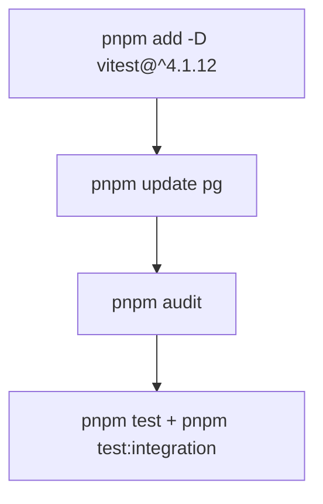
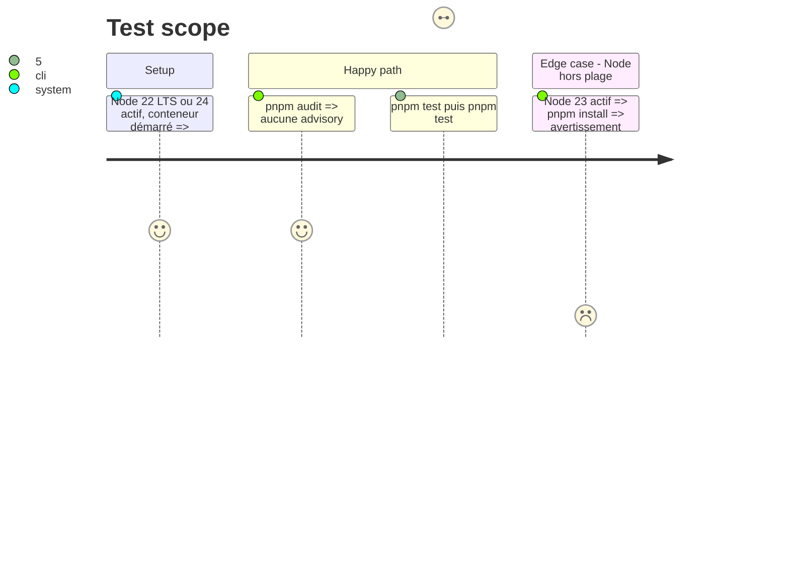

# Instruction: Dépendances : vitest 4, pg

## Architecture projection

> Tree of the final files. ✅ create · ✏️ modify · ❌ delete

```txt
.
├── package.json                      ✏️ vitest ^4.1.12, pg ^8.23.1, engines ^22.12 || >=24
├── pnpm-lock.yaml                    ✏️ régénéré
├── vitest.config.js                  ✏️ seulement si la v4 l'exige (attendu : inchangé)
└── vitest.integration.config.js      ✏️ seulement si la v4 l'exige (attendu : inchangé)
```

## User Journey



## Test Scope



## Tasks to do

### `1)` Monter vitest

> Supprimer les 12 advisories.

1. `pnpm add -D vitest@^4.1.12`.
2. Lancer les deux suites ; n'adapter les configurations que sur erreur ou dépréciation affichée.

### `2)` Monter pg

1. `pnpm update pg` (8.23.1).

### `3)` Moteurs Node

> Le projet déclare ce que ses outils supportent.

1. `package.json` : `engines.node` à `^22.12.0 || >=24`.
2. Aligner la matrice CI de la phase 1 (Node 22, 24) si elle diffère.

## Test acceptance criteria

| Task | Acceptance criteria |
| ---- | ------------------- |
| 1 | `pnpm audit` ne remonte aucune vulnérabilité ; les deux suites passent sous vitest 4 avec les mêmes comptes qu'avant la montée (tests ajoutés en phase 1 compris). |
| 2 | `pnpm outdated` ne liste plus `pg`. |
| 3 | `engines` exclut Node 23 et la CI passe sur Node 22 et 24. |
