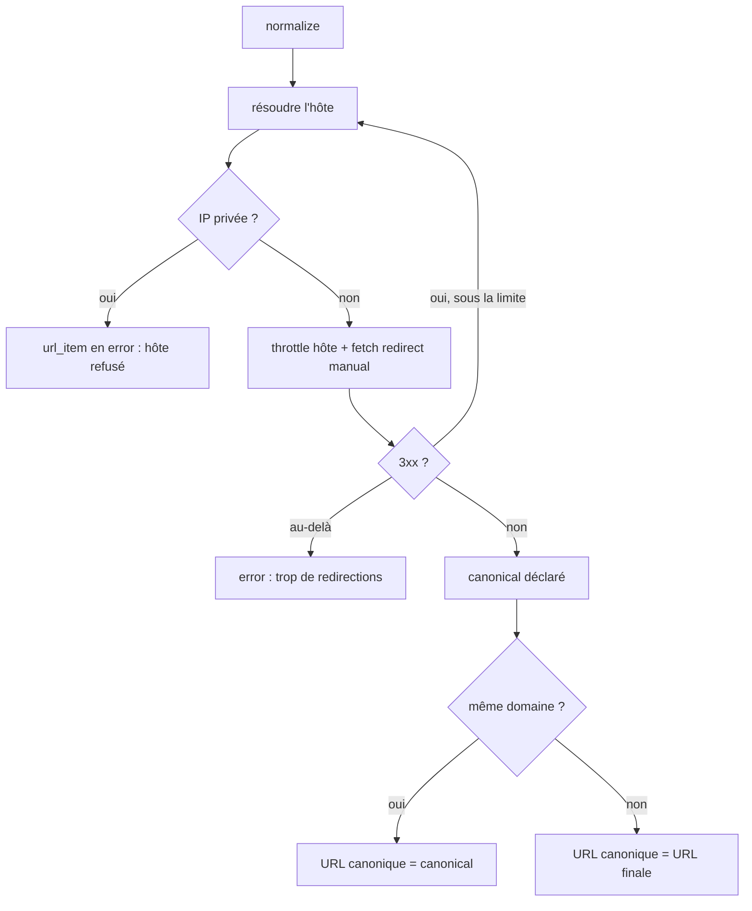
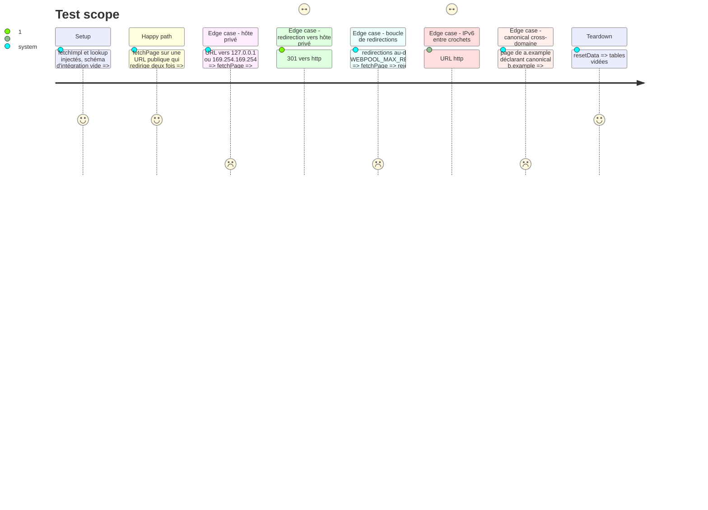

# Instruction: Surface réseau : SSRF, redirections, canonical

## Architecture projection

> Tree of the final files. ✅ create · ✏️ modify · ❌ delete

```txt
.
├── src/
│   ├── config.js                     ✏️ WEBPOOL_MAX_REDIRECTS, WEBPOOL_ALLOW_PRIVATE_HOSTS
│   └── normalize/
│       ├── fetcher.js                ✏️ redirections manuelles, garde d'hôte et throttle à chaque saut
│       ├── hostGuard.js              ✅ résolution DNS + net.BlockList (loopback, privées, link-local, ULA, CGNAT)
│       └── index.js                  ✏️ canonical accepté seulement sur le même domaine
├── test/
│   ├── fetcher.test.js               ✏️ redirections, throttle par saut, refus d'hôte
│   ├── hostGuard.test.js             ✅ plages bloquées et autorisées (lookup injecté)
│   └── integration/
│       └── pipeline.test.js          ✏️ canonical cross-domaine ignoré
└── README.md                         ✏️ Politesse réseau : garde d'hôte et nouveaux réglages
```

## User Journey



## Test Scope



## Tasks to do

### `1)` Garde d'hôte

> Aucune requête ne part vers une adresse non publique.

1. `hostGuard.js` : `assertPublicHost(hostname, { lookup })`, IP littérale ou `lookup(hostname, { all: true })` (défaut `dns.promises.lookup`), refus si une adresse est dans la `BlockList`.
2. Normaliser avant contrôle : retirer les crochets d'un hôte IPv6 (`new URL().hostname` renvoie `[::1]`), convertir une IPv4 mappée `::ffff:a.b.c.d` en IPv4.
3. Plages : `0.0.0.0/8`, `10/8`, `100.64/10`, `127/8`, `169.254/16`, `172.16/12`, `192.168/16`, `::`, `::1`, `fc00::/7`, `fe80::/10`.
4. `WEBPOOL_ALLOW_PRIVATE_HOSTS=1` désactive la garde (intranet assumé).
5. Injection pour les tests, sans réseau : `createFetcher({ fetchImpl, lookup })` ; `normalizePending({ fetchImpl })` fournit au fetcher un `lookup` qui renvoie une IP publique fixe (`93.184.216.34`) dès que `fetchImpl` est injecté. Les hôtes de test (`a.com`, `b.com`, `example.com`, `unsplash.com`) ne sont donc jamais résolus. `test/fetcher.test.js`, qui appelle `createFetcher` directement, passe le même `lookup` factice à tous ses cas.
7. `WEBPOOL_MAX_REDIRECTS` lu via `intEnv(…, 5, 0)` (phase 1).
6. Hors périmètre, volontairement : `src/providers/http.js` (appels SERP, dont SearXNG local sur `localhost`) n'est pas filtré ; seule la normalisation visite des URL venues de l'extérieur.

### `2)` Redirections manuelles

> Chaque saut est validé et espacé.

1. `fetcher.js` : `redirect: 'manual'`, boucle sur 301/302/303/307/308 avec `location` résolue contre l'URL courante ; un 3xx sans `location` est traité comme la réponse finale (statut ≥ 300 donc `error`, comme aujourd'hui pour un 4xx).
2. À chaque saut : `assertPublicHost`, puis `throttle(host)` ; limite `WEBPOOL_MAX_REDIRECTS` (défaut 5).
3. Rendre `finalUrl` = dernière URL suivie (plus `res.url`).
4. Les retries portent sur la chaîne entière, pas sur un saut isolé.

### `3)` Canonical restreint

> Une page ne peut pas revendiquer l'URL d'un autre domaine.

1. `normalize/index.js` : retenir `declaredCanonical` seulement si `domainOf(canonicalizeUrl(declared)) === domainOf(canonicalizeUrl(finalUrl))`. Comparaison sur l'hôte exact, `www.` retiré : `m.example.com` → `example.com` est refusé. Choix assumé (pas de Public Suffix List, donc pas de dépendance) : un faux refus garde seulement l'URL finale, sans fusion abusive.
2. Test d'intégration : la page cross-domaine garde son URL finale et n'est pas fusionnée.

### `4)` Documentation

1. README, Politesse réseau : garde d'hôte, `WEBPOOL_MAX_REDIRECTS`, `WEBPOOL_ALLOW_PRIVATE_HOSTS`, règle du canonical.

## Test acceptance criteria

| Task | Acceptance criteria |
| ---- | ------------------- |
| 1 | Une URL vers loopback, plage privée, link-local, métadonnées cloud, `[::1]` ou `[::ffff:127.0.0.1]` passe l'item en `error` sans requête émise ; `pnpm test` et `pnpm test:integration` passent sans accès DNS. |
| 2 | Une redirection vers un hôte privé est refusée au saut ; deux requêtes successives vers un même hôte de redirection sont espacées de `perHostDelayMs` ; au-delà de la limite, l'item est en `error`. |
| 3 | Un canonical d'un autre domaine n'est pas appliqué ; un canonical du même domaine l'est toujours. |
| 4 | Le README décrit les deux réglages et la règle du canonical. |
