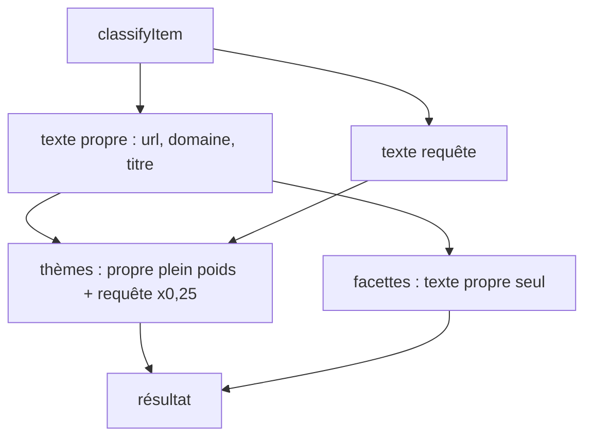
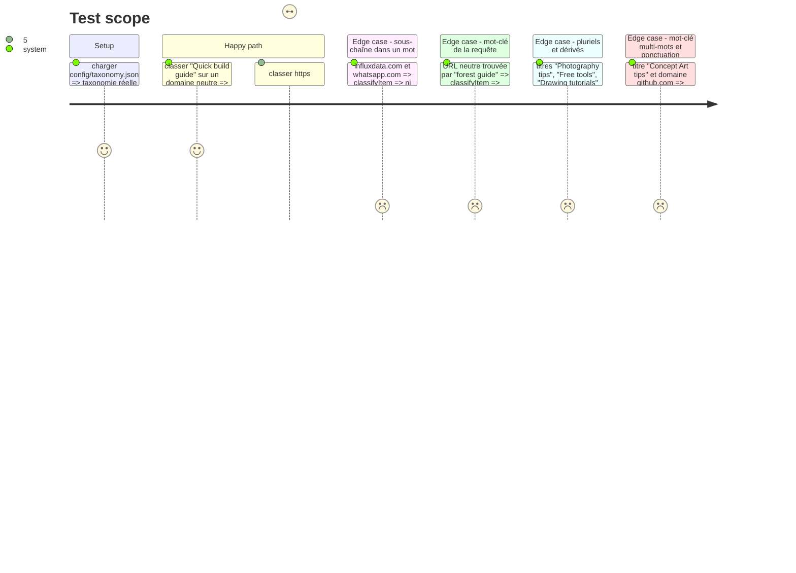

# Instruction: Précision du classifieur

## Architecture projection

> Tree of the final files. ✅ create · ✏️ modify · ❌ delete

```txt
.
├── src/
│   └── classify/
│       └── classifier.js             ✏️ correspondance à frontières de mot, facettes sur le contenu propre
└── test/
    ├── classifier.test.js            ✏️ frontières de mot, facettes indépendantes de la requête
    └── taxonomy.test.js              ✅ non-régression sur config/taxonomy.json
```

## User Journey



## Test Scope



## Tasks to do

### `1)` Correspondance à frontières de mot

> Un mot-clé ne correspond plus à l'intérieur d'un autre mot.

1. Compiler chaque mot-clé ou motif une fois en `RegExp` échappée, flag `u`.
2. Ajouter `(?<![\p{L}\p{N}])` en tête seulement si le motif commence par une lettre ou un chiffre ; **aucune frontière de fin** : les mots-clés de la taxonomie sont des racines (`photo` doit trouver `photography`, `tutorial` → `tutorials`, `tool` → `tools`, `tuto` → `tutorial`, `illustration` → `illustrations`). `app.` reste un préfixe d'hôte, `github.com` reste valable dans une URL.
3. Mettre la compilation en cache par taxonomie (`WeakMap`) : pas de recompilation par item.
4. Appliquer le même matcher à `countHits`, `pickFacets` et `relevanceScore`.

### `2)` Facettes sur le contenu propre

> La requête ne décide plus du type de contenu ni de la licence.

1. `pickFacets(own, …)` au lieu de `haystack` ; mettre à jour le commentaire US-08.

### `3)` Non-régression sur la taxonomie réelle

1. `test/taxonomy.test.js` : les cas vérifiés pendant l'audit (`build`, `influxdata`, `whatsapp`, `forest guide`) et les cas positifs attendus (`unsplash.com` → photographie et licence libre, `youtube.com` → vidéo, `docs.` → tutoriel).
2. Rappel préservé : titres « Photography tips », « Free tools », « Drawing tutorials », « Vector illustrations » gardent leur thème ou facette.

## Test acceptance criteria

| Task | Acceptance criteria |
| ---- | ------------------- |
| 1 | « Quick build guide » n'est plus classé `design` ; `influxdata.com` non plus ; `whatsapp.com` n'a plus la facette `outil` ; `app.example.com` l'a ; « Photography tips », « Free tools » et « Drawing tutorials » restent détectés. Le reste de `pnpm test` passe sans modification des attentes existantes. |
| 2 | Avec la requête « forest guide », une URL neutre reçoit `article`, pas `tutoriel`. |
| 3 | La suite échoue si un mot-clé de `config/taxonomy.json` réintroduit un faux positif listé. |
