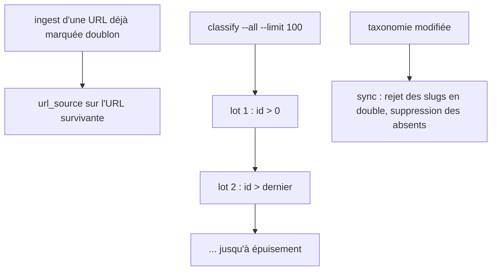
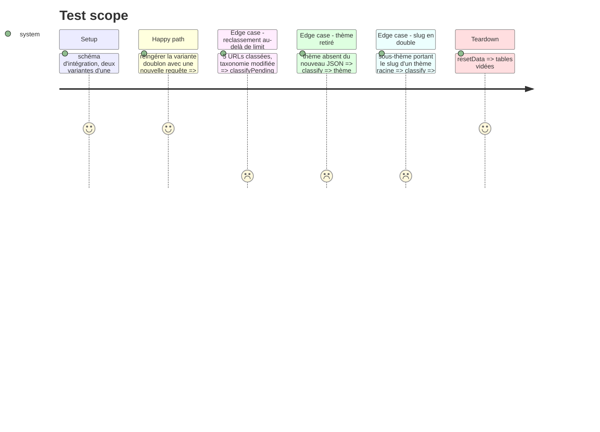

# Instruction: Défauts de données : ingest, classify --all, taxonomie

## Architecture projection

> Tree of the final files. ✅ create · ✏️ modify · ❌ delete

```txt
.
├── src/
│   ├── ingest/
│   │   └── index.js                  ✏️ source rattachée au survivant (coalesce(duplicate_of, id))
│   └── classify/
│       └── index.js                  ✏️ --all paginé par curseur ; sync taxonomie : doublons rejetés, absents supprimés
├── bin/
│   └── webpool.js                    ✏️ aide : sens de --limit avec --all
├── test/
│   └── integration/
│       └── pipeline.test.js          ✏️ réingestion d'un doublon, --all au-delà de limit, resync avec retrait
└── README.md                         ✏️ classify --all, taxonomie source de vérité
```

## User Journey



## Test Scope



## Tasks to do

### `1)` Traçabilité des doublons à l'ingest

> Une requête n'est jamais rattachée à un item doublon.

1. `ingest/index.js` : sur conflit, `SELECT coalesce(duplicate_of, id) AS id FROM url_item WHERE raw_url = $1`.
2. Compter ce cas dans `existing`.

### `2)` `classify --all` complet

> Le reclassement couvre tout le corpus.

1. `classifyPending` : en mode `reclassify`, boucler par lots de `limit` avec `ui.id > $last` jusqu'à un lot vide ; sans `--all`, comportement inchangé (un lot).
2. Aide du CLI et README : avec `--all`, `--limit` est la taille de lot.

### `3)` Synchronisation de taxonomie

> La base reflète exactement le JSON.

1. Valider avant écriture : slugs uniques sur thèmes, sous-thèmes et facettes ; sinon `Error` nommant le slug.
2. Après upsert, `DELETE FROM theme WHERE slug <> ALL($1)` (enfants d'abord), idem `facet_definition` ; le tout dans une transaction.

## Test acceptance criteria

| Task | Acceptance criteria |
| ---- | ------------------- |
| 1 | Après réingestion d'une variante doublon, toutes ses `url_source` pointent vers la survivante. |
| 2 | `classify --all --limit 2` sur 5 URLs classées en reclasse 5, et le compte du run vaut 5. |
| 3 | Un thème retiré du JSON disparaît de `theme` et des classifications ; un slug en double fait échouer le run avec un message explicite, sans rien écrire. |
