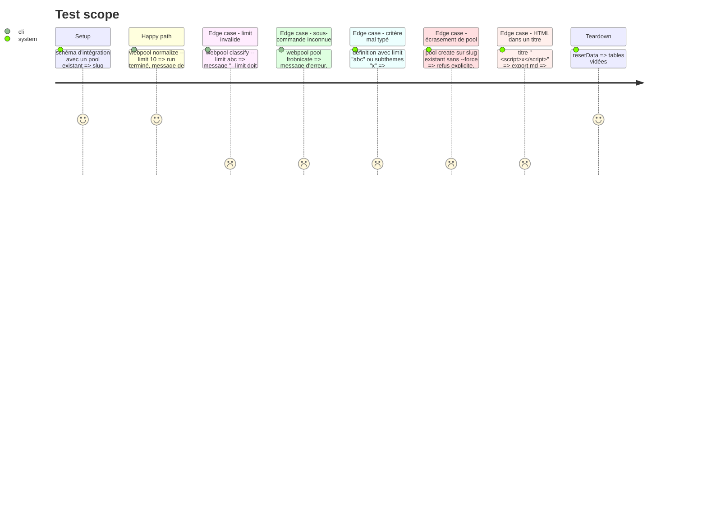

# Instruction: Robustesse et nettoyage (validation, CLI, refactors)

## Architecture projection

> Tree of the final files. ✅ create · ✏️ modify · ❌ delete

```txt
.
├── bin/
│   └── webpool.js                    ✏️ --limit validé, --force pour pool create, stats déplacé
├── src/
│   ├── config.js                     ✏️ User-Agent versionné depuis package.json, config gelée
│   ├── db.js                         ✏️ ROLLBACK qui échoue n'écrase plus l'erreur d'origine
│   ├── run.js                        ✏️ withRun(kind, detail, fn)
│   ├── stats.js                      ✅ requêtes de webpool stats
│   ├── ingest/
│   │   └── index.js                  ✏️ withRun, pendingCount supprimé
│   ├── normalize/
│   │   └── index.js                  ✏️ withRun
│   ├── classify/
│   │   └── index.js                  ✏️ withRun, taxonomie passée en paramètre
│   └── pools/
│       ├── criteria.js               ✏️ types des critères et limit validés
│       ├── export.js                 ✏️ HTML échappé dans l'export md
│       └── index.js                  ✏️ withRun, createPool refuse l'écrasement sans force
├── test/
│   ├── cli.test.js                   ✅ CLI via execFile : aide, sous-commande inconnue, --limit invalide
│   ├── criteria.test.js              ✏️ critères mal typés
│   ├── export.test.js                ✏️ titre contenant du HTML
│   └── integration/
│       └── pipeline.test.js          ✏️ taxonomie passée en option au lieu de muter config ; pool create sans/avec force
└── README.md                         ✏️ pool create --force
```

## User Journey

```mermaid
flowchart TD
  A[webpool pool create --slug x] --> B{slug existant ?}
  B -- non --> C[créé et matérialisé]
  B -- oui, sans --force --> D[erreur : pool existant, utiliser --force]
  B -- oui, --force --> E[définition remplacée et rematérialisée]
```

## Test Scope



## Tasks to do

### `1)` Validation des entrées

> Une entrée invalide produit un message clair avant toute requête.

1. `bin/webpool.js` : `--limit` entier strictement positif, sinon erreur.
2. `criteria.js` : `theme` chaîne, `subthemes` / `domains_*` tableaux de chaînes, `facets` objet de chaînes, `min_*` nombres dans [0, 1], `limit` entier.

### `2)` Patron de run

> Le cycle startRun / finishRun n'existe qu'à un endroit.

1. `run.js` : `withRun(kind, detail, fn)` démarre le run, appelle `fn(runId)` qui renvoie un objet de détail ; en succès, clôt en `done` avec ce détail et renvoie `{ runId, ...détail }` ; en échec, clôt en `failed` avec l'erreur puis la relance.
2. Remplacer les quatre copies (ingest, normalize, classify, pool refresh) en gardant leurs valeurs de retour actuelles. L'ingest valide le provider et `--query` **avant** `withRun` : une entrée invalide ne crée aucun run.
3. Supprimer `pendingCount`.

### `3)` Petites corrections

1. `db.js` : `await client.query('ROLLBACK').catch(() => {})`.
2. `export.js` : échapper `&`, `<`, `>` dans `mdCell` et le titre lié.
3. `config.js` : version du User-Agent lue dans `package.json` ; `Object.freeze(config)`.
4. `classifyPending({ taxonomy })` : taxonomie injectable ; les tests d'intégration l'utilisent au lieu de muter `config.taxonomyPath`.
5. `src/stats.js` reçoit le SQL de `stats()`.

### `4)` `pool create` explicite

1. `createPool({ force })` : sans `force`, erreur si le slug existe ; `--force` dans le CLI, l'aide et le README (section pools, exemple `pool create`, ligne 95 aujourd'hui).
2. `pipeline.test.js` : le test existant qui recrée un pool sur un slug existant (ligne 254 aujourd'hui) passe `force: true` ; ajouter le cas sans `force` qui doit échouer.

### `5)` Tests du CLI

1. `test/cli.test.js` : `execFile(node, ['bin/webpool.js', …])` pour l'aide, une sous-commande inconnue et un `--limit` invalide (aucune base requise : la validation précède la connexion).

## Test acceptance criteria

| Task | Acceptance criteria |
| ---- | ------------------- |
| 1 | `--limit abc`, `--limit -3` et un critère mal typé sont refusés avec un message qui nomme l'option ou le critère. |
| 2 | Un run qui échoue est clos en `failed` avec son erreur, un run réussi en `done` avec ses compteurs, pour les quatre commandes ; les valeurs de retour exposées au CLI sont inchangées ; un provider inconnu ne crée aucune ligne `run`. |
| 3 | Un titre HTML ressort échappé en Markdown ; le User-Agent porte la version de `package.json` ; modifier `config` lève une erreur. |
| 4 | `pool create` sur un slug existant échoue sans `--force` et réussit avec. |
| 5 | Les tests du CLI passent sans base démarrée. |
