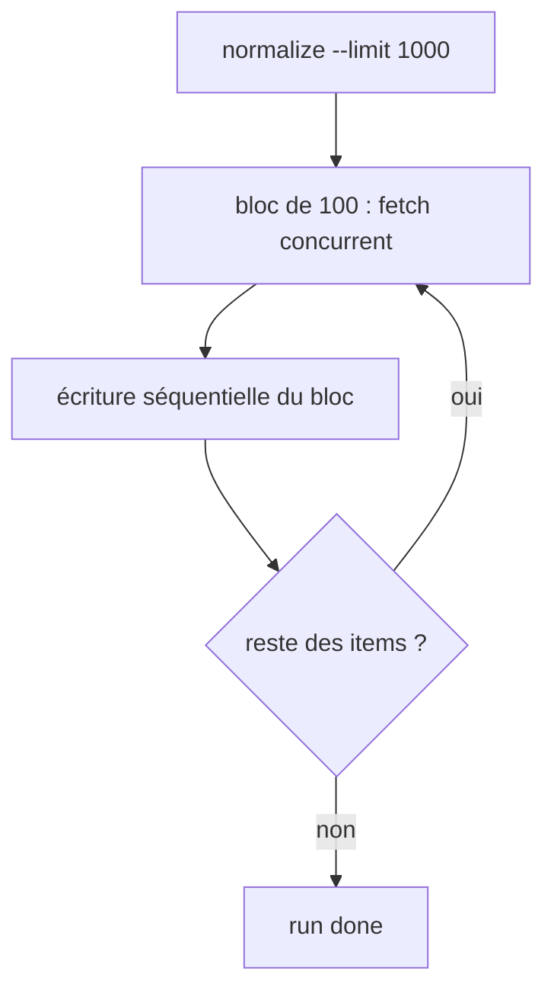
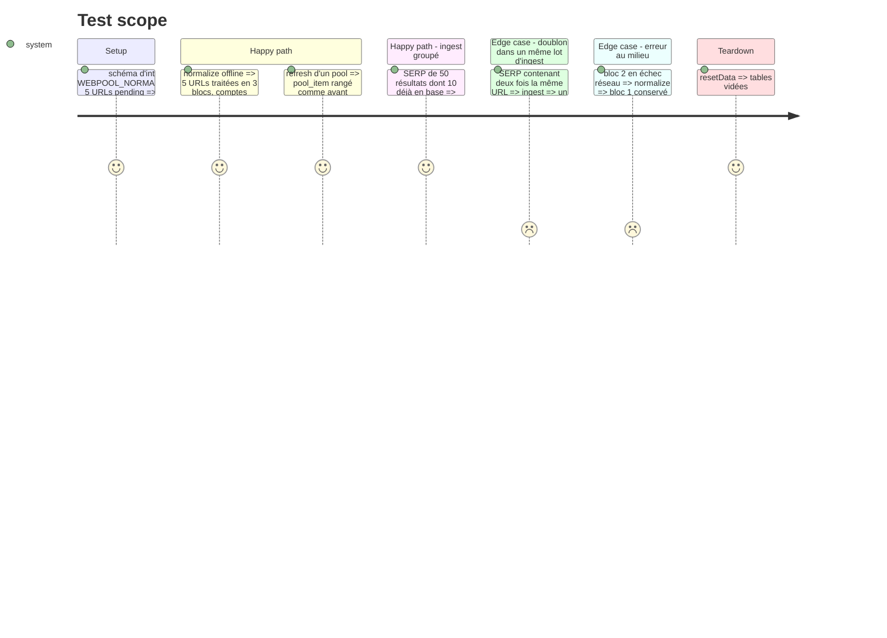

# Instruction: Performance : traitement par blocs, écritures groupées

## Architecture projection

> Tree of the final files. ✅ create · ✏️ modify · ❌ delete

```txt
.
├── src/
│   ├── config.js                     ✏️ WEBPOOL_NORMALIZE_CHUNK (défaut 100)
│   ├── ingest/
│   │   └── index.js                  ✏️ insert groupé url_item + url_source via unnest, une transaction
│   ├── normalize/
│   │   └── index.js                  ✏️ réseau puis écriture par blocs
│   ├── classify/
│   │   └── index.js                  ✏️ persistance par lot, inserts multi-lignes
│   └── pools/
│       └── index.js                  ✏️ refresh en INSERT … SELECT
└── test/
    └── integration/
        └── pipeline.test.js          ✏️ normalize sur plus d'un bloc, ingest avec doublons intra-lot
```

## User Journey



## Test Scope



## Tasks to do

### `1)` Normalisation par blocs

> La mémoire est bornée et le travail déjà fait survit à un plantage.

1. Découper `items` en blocs de `WEBPOOL_NORMALIZE_CHUNK` (lu via `intEnv(…, 100, 1)`, phase 1) ; pour chaque bloc, `mapLimit` puis écritures, avant de passer au suivant.
2. La déduplication reste séquentielle et dans l'ordre des id.

### `2)` Ingest groupé

1. `INSERT INTO url_item (raw_url, title) SELECT * FROM unnest($1::text[], $2::text[]) ON CONFLICT DO NOTHING`, puis lecture des id (`coalesce(duplicate_of, id)`, cf. phase 5) en une requête.
2. Insert de toutes les `url_source` en un seul `unnest` ; `inserted` / `existing` calculés à partir des retours.

### `3)` Refresh de pool et classification groupés

1. `refreshPool` : `INSERT INTO pool_item SELECT … FROM unnest($ids, $scores) WITH ORDINALITY`.
2. `classifyPending` : une transaction par lot, `DELETE … WHERE url_item_id = ANY($1)` puis inserts multi-lignes.

## Test acceptance criteria

| Task | Acceptance criteria |
| ---- | ------------------- |
| 1 | Avec un bloc de 2, normalize sur 5 URLs donne les mêmes statuts et comptes qu'avant ; une panne au bloc 2 laisse le bloc 1 écrit. |
| 2 | Une SERP de 50 résultats (dont 10 URL déjà en base) donne 50 `url_source`, `inserted` = 40 et `existing` = 10 ; une URL répétée dans la SERP donne un item et deux sources. |
| 3 | Rangs et scores des pools sont identiques à avant ; `pnpm test:integration` passe sans modification des attentes existantes. |
