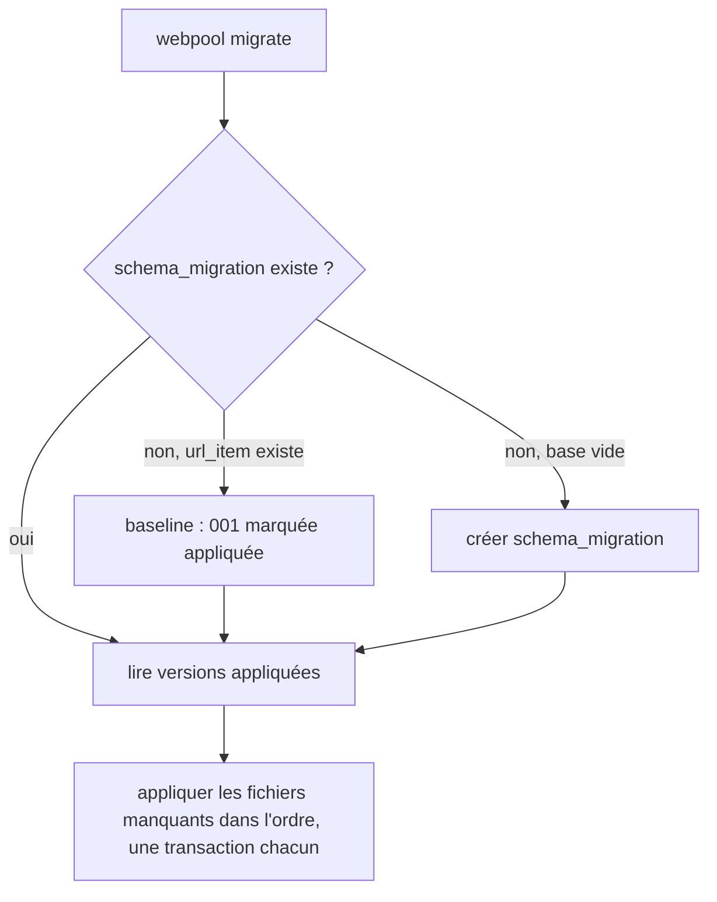
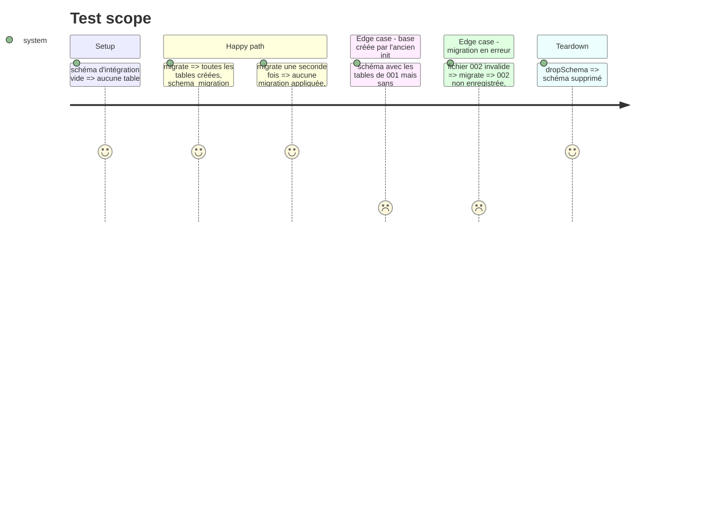

# Instruction: Migrations versionnées

## Architecture projection

> Tree of the final files. ✅ create · ✏️ modify · ❌ delete

```txt
.
├── bin/
│   └── webpool.js                    ✏️ commande migrate
├── db/
│   ├── init/
│   │   └── 001_init.sql              ❌ déplacé
│   └── migrations/
│       └── 001_init.sql              ✅ baseline (contenu de l'ancien init, BEGIN/COMMIT retirés)
├── docker-compose.yml                ✏️ montage docker-entrypoint-initdb.d retiré
├── package.json                      ✏️ db:up enchaîne la migration, db:reset aussi
├── src/
│   └── migrate.js                    ✅ runner : table schema_migration, baseline, une transaction par fichier
├── test/
│   └── integration/
│       ├── helpers.js                ✏️ createSchema applique les migrations via le runner
│       └── migrate.test.js           ✅ base vide, base existante sans table, rejeu idempotent
└── README.md                         ✏️ Démarrage et Structure : webpool migrate, db/migrations
```

## User Journey



## Test Scope



## Tasks to do

### `1)` Runner de migrations

> Le schéma évolue sans perdre le corpus.

1. `src/migrate.js` exporte `migrate({ client, dir = 'db/migrations' })` et n'importe ni `src/db.js` ni `src/config.js` : `helpers.createSchema` l'appelle avec son client admin (sinon `config` serait figé sur le schéma `public` avant `setup.js`, cf. phase 1) ; la commande `webpool migrate` lui passe un client de `getPool()`. `dir` injectable pour les tests.
2. `CREATE TABLE IF NOT EXISTS schema_migration (version TEXT PRIMARY KEY, applied_at TIMESTAMPTZ DEFAULT now())`.
3. Baseline : si `schema_migration` est vide et `url_item` existe, enregistrer `001` sans l'exécuter.
4. Appliquer chaque `db/migrations/NNN_*.sql` absent, dans l'ordre, dans une transaction avec son insert de version.
5. `pg_advisory_lock` le temps du run : deux `migrate` concurrents ne se chevauchent pas.

### `2)` Bascule du schéma

1. Déplacer `db/init/001_init.sql` vers `db/migrations/001_init.sql`, sans `BEGIN`/`COMMIT`.
2. `docker-compose.yml` : retirer le montage `./db/init`.
3. `package.json` : `db:up` = `docker compose up -d --wait && node bin/webpool.js migrate` ; `db:reset` idem.
4. `helpers.js` : `createSchema` crée le schéma, fixe `search_path`, puis appelle `migrate({ client })` avec son client admin.
5. `migrate.test.js` : le cas « 002 invalide » passe un `dir` temporaire contenant `001` et un `002` en erreur.

### `3)` Documentation

1. README : `webpool migrate`, règle « une migration par changement de schéma, jamais modifier une migration publiée ».

## Test acceptance criteria

| Task | Acceptance criteria |
| ---- | ------------------- |
| 1 | `migrate` sur base vide crée le schéma ; un rejeu n'applique rien ; une base de l'ancien init garde ses données et passe en baseline ; une migration en erreur n'est ni appliquée ni enregistrée. |
| 2 | `pnpm db:reset` rend une base migrée ; la base locale existante (volume `webpool_pgdata`) migre sans `db:reset`. |
| 3 | Le README décrit la commande et la règle d'écriture des migrations. |
