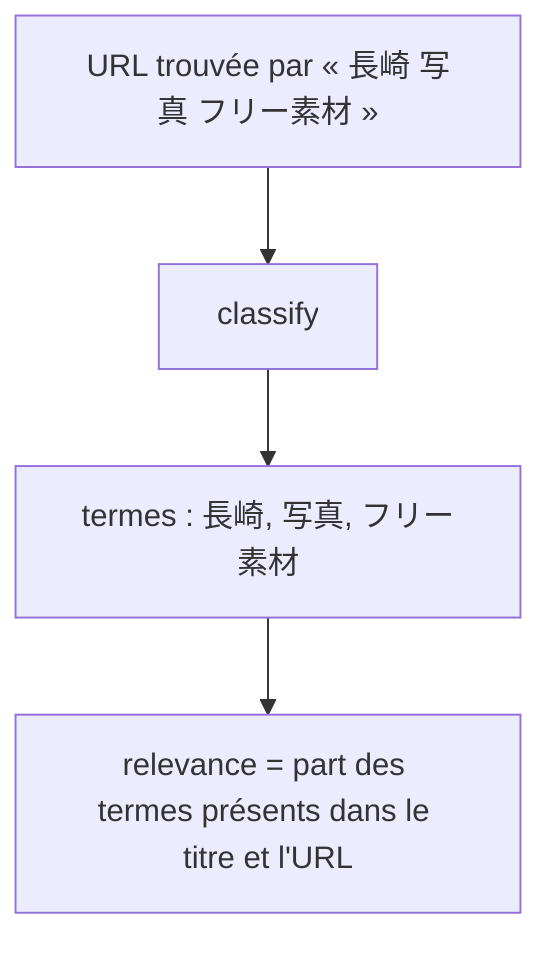
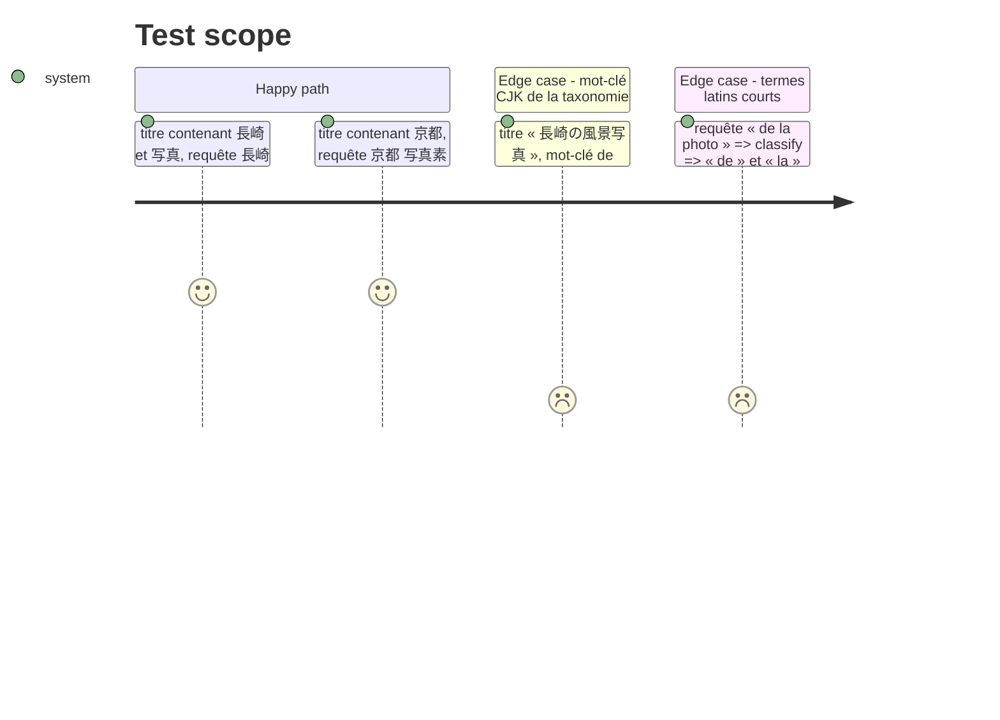

<!-- Fill or omit these sections; never add, rename, or reorder one. -->

# Instruction: Notes de pertinence pour les requêtes en écriture CJK

## Architecture projection

> Tree of the final files. ✅ create · ✏️ modify · ❌ delete

```txt
.
├── src/classify/classifier.js       ✏️ relevanceScore garde les termes CJK de 2 caractères ; compileKeyword sans garde de début devant un caractère han, hiragana ou katakana
└── test/classifier.test.js          ✏️ cas 長崎 / 京都 / 写真, mot-clé CJK de la taxonomie au milieu d'un texte, non-régression latine et coréenne
```

## User Journey



## Test Scope



## Tasks to do

### `1)` Découpage des termes

> Un terme CJK de 2 caractères porte autant de sens qu'un mot latin de 4.

1. Dans `relevanceScore`, longueur minimale 2 pour un terme qui contient un caractère `\p{Script=Han}`, `Hiragana`, `Katakana` ou `Hangul` ; 3 sinon.
2. `compileKeyword` (`src/classify/classifier.js:10`) exige l'absence de lettre avant le terme (`(?<![\p{L}\p{N}])`) : dans « 長崎の風景写真 », 写真 suit 景 et n'est pas reconnu. Ne pas poser cette garde quand le terme commence par un caractère han, hiragana ou katakana (écritures sans espaces) ; elle reste pour les termes latins et coréens. `compileKeyword` sert aussi aux mots-clés de la taxonomie (`matchers`), dont 19 lignes de `config/taxonomy.json` contiennent du CJK : ils seront eux aussi reconnus au milieu d'un texte, ce qui est voulu (même défaut) et peut changer des thèmes au prochain `classify --all`.

### `2)` Tests

> Les cas mesurés en production deviennent des tests.

1. Ajouter les cas du Test Scope à `test/classifier.test.js`.

## Test acceptance criteria

| Task | Acceptance criteria |
| ---- | ------------------- |
| 1 | Une URL titrée « 長崎の風景写真 » trouvée par « 長崎 写真 フリー素材 » obtient une relevance de 2/3 (0,667). |
| 1 | Un mot-clé CJK de la taxonomie est reconnu au milieu d'un titre japonais ; un mot-clé latin ou coréen ne l'est toujours pas à l'intérieur d'un mot. |
| 1 | Les termes latins de 2 caractères restent ignorés : aucun test existant de `classifier.test.js` ne change de résultat. |
| 2 | Les 178 tests unitaires et les nouveaux passent. |
