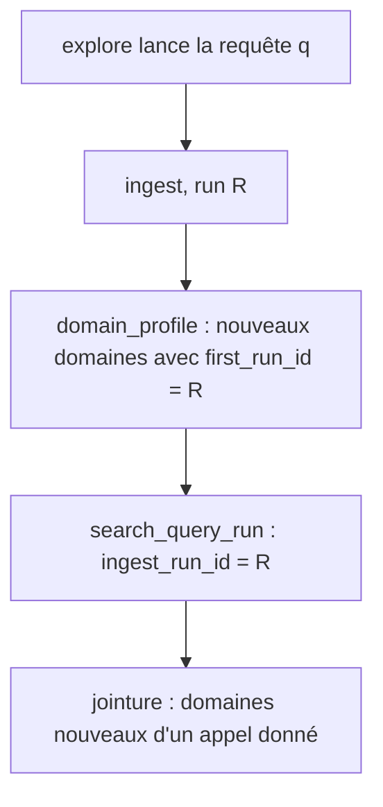
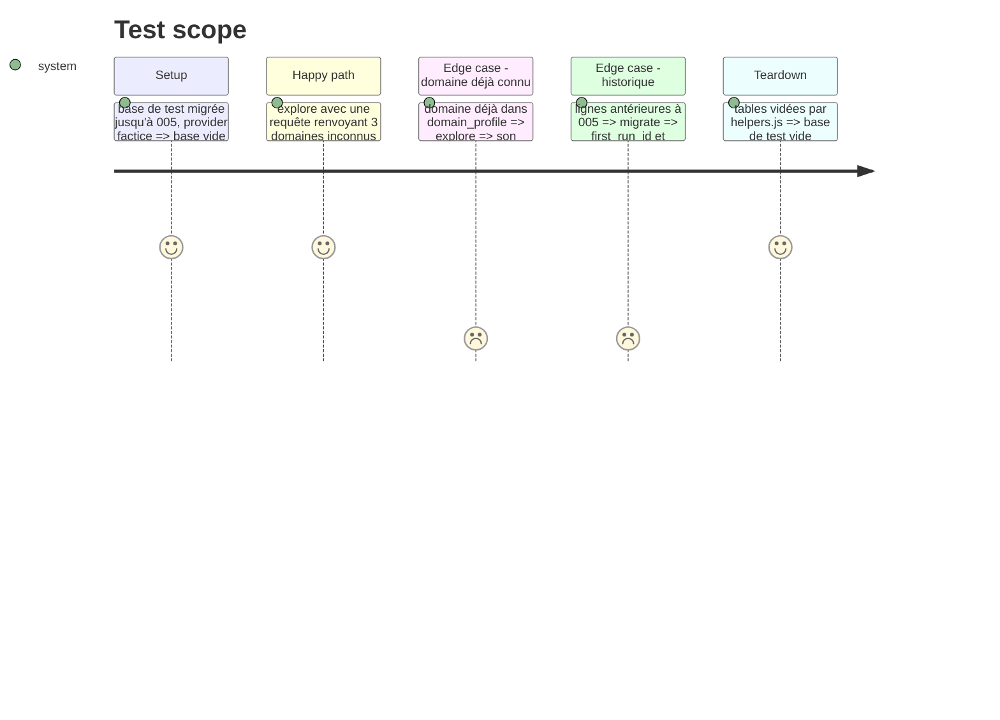

<!-- Fill or omit these sections; never add, rename, or reorder one. -->

# Instruction: Lien entre chaque domaine nouveau et l'appel qui l'a trouvé

## Architecture projection

> Tree of the final files. ✅ create · ✏️ modify · ❌ delete

```txt
.
├── db/migrations/005_domain_run.sql ✅ domain_profile.first_run_id, search_query_run.ingest_run_id (nullables, index)
├── src/domains/index.js             ✏️ registerDomains(client, domains, firstQuery, runId) remplit first_run_id
├── src/ingest/index.js              ✏️ transmet son runId à registerDomains
├── src/explore/index.js             ✏️ enregistre ingest_run_id dans search_query_run
└── test/integration/explore.test.js ✏️ un appel relie ses domaines nouveaux à son search_query_run
```

## User Journey



## Test Scope



## Tasks to do

### `1)` Migration 005

> Deux colonnes nullables : l'historique reste lisible, seuls les nouveaux appels sont reliés.

1. `ALTER TABLE domain_profile ADD COLUMN first_run_id` et `ALTER TABLE search_query_run ADD COLUMN ingest_run_id`, du type de l'id de la table des runs, avec index.

### `2)` Remplissage

> Le run ingest est l'unité commune aux deux tables.

1. `registerDomains` accepte un `runId` et l'insère ; `normalize` continue de l'appeler sans runId.
2. `ingest` passe son runId ; `explore` lit le `runId` renvoyé par `withRun` et le stocke dans `ingest_run_id`.

## Test acceptance criteria

| Task | Acceptance criteria |
| ---- | ------------------- |
| 1 | `migrate` sur une base en 004 ajoute les deux colonnes sans toucher aux lignes existantes. |
| 2 | Après un `explore`, chaque domaine nouveau d'un appel est retrouvé par jointure `search_query_run.ingest_run_id = domain_profile.first_run_id`. |
| 2 | Les 56 tests d'intégration existants passent. |
