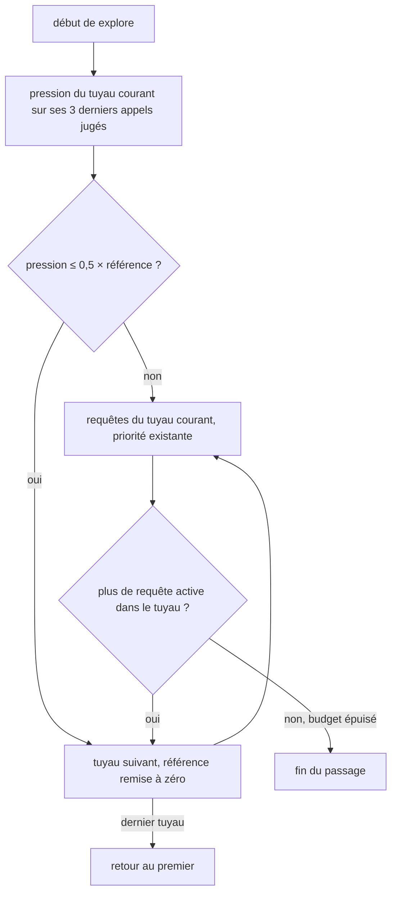
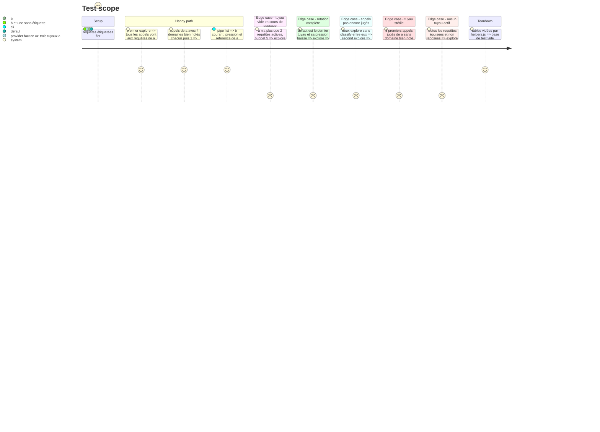

<!-- Fill or omit these sections; never add, rename, or reorder one. -->

# Instruction: Tuyaux : pression, bascule et rotation

## Architecture projection

> Tree of the final files. ✅ create · ✏️ modify · ❌ delete

```txt
.
├── db/migrations/006_explore_pipe.sql ✅ explore_pipe(slug PK, entered_at, is_current) ; la référence se recalcule, elle n'est pas stockée
├── src/explore/pipes.js               ✅ pipeOf(tags), pressure(runs), shouldSwitch(...), nextPipe(...) : fonctions pures
├── src/explore/index.js               ✏️ explore : évalue le tuyau courant, choisit ses requêtes, passe le reste du budget au suivant
├── src/config.js                      ✏️ pipeGoodScore (0,5), pipeWindow (3), pipeDropRatio (0,5), variables WEBPOOL_PIPE_*
├── bin/webpool.js                     ✏️ commande `pipe list` : tuyaux, requêtes actives, pression, référence, tuyau courant
├── test/pipes.test.js                 ✅ pression, bascule, rotation, retour au premier, tuyau defaut
├── test/config.test.js                ✏️ variables WEBPOOL_PIPE_*
└── test/integration/explore.test.js   ✏️ explore suit le tuyau courant et bascule
```

## User Journey



## Test Scope



## Tasks to do

### `1)` Fonctions pures

> Tout le raisonnement se teste sans base.

1. `pipeOf(tags)` : slug de la première étiquette `flot:`, sinon `defaut`.
2. Un appel est jugé quand aucune URL de ses domaines nouveaux n'est en `pending` ni en `normalized` (`error` et `duplicate` comptent comme terminées) ; un domaine sans URL classée n'est pas bien noté. `pressure(judgedRuns)` = domaines bien notés ÷ appels réussis. La référence de la visite est la pression des `window` premiers appels jugés depuis `entered_at` ; la pression courante, celle des `window` derniers ; `null` tant qu'il y a moins de `window` appels jugés, et aucune bascule sur `null`. Bascule quand pression ≤ `dropRatio` × référence : un tuyau dont la référence et la pression sont nulles bascule.
3. `shouldSwitch({ pressure, reference, dropRatio, activeQueries })` et `nextPipe(pipes, current)` dans l'ordre de première apparition, avec retour au premier.

### `2)` État et requêtes

> Une seule ligne `is_current` à la fois ; entrer dans un tuyau met `entered_at` à maintenant, ce qui remet sa référence à zéro.

1. Migration 006 ; `explore` lit les appels du tuyau depuis `entered_at` en joignant `search_query_run`, `domain_profile.first_run_id` et la meilleure note par domaine dans `url_item`.
2. Dans `explore`, après `wakeRested` : évaluer, basculer si besoin, puis `selectQueries` restreint au tuyau ; budget restant au tuyau suivant tant qu'il en reste un avec des requêtes actives, sans revisiter un tuyau dans le même passage.
3. Paramètres dans `src/config.js`, commande `pipe list`.

## Test acceptance criteria

| Task | Acceptance criteria |
| ---- | ------------------- |
| 1 | `test/pipes.test.js` couvre sans base : pression, appel non jugé, `null` sous `window`, bascule au seuil et sous le seuil, référence nulle, rotation et retour au premier, tuyau `defaut`. |
| 2 | `test/integration/explore.test.js` couvre : tuyau vidé en cours de passage, deux explore sans classify, aucun tuyau actif. |
| 2 | Avec trois tuyaux, des `explore` successifs vont à a, puis à b dès que la pression de a passe sous la moitié de sa référence, puis à defaut, puis de nouveau à a. |
| 2 | Un passage ne relance jamais un tuyau déjà quitté dans ce même passage. |
| 3 | `webpool pipe list` affiche chaque tuyau avec son nombre de requêtes actives, sa pression, sa référence et le tuyau courant. |
