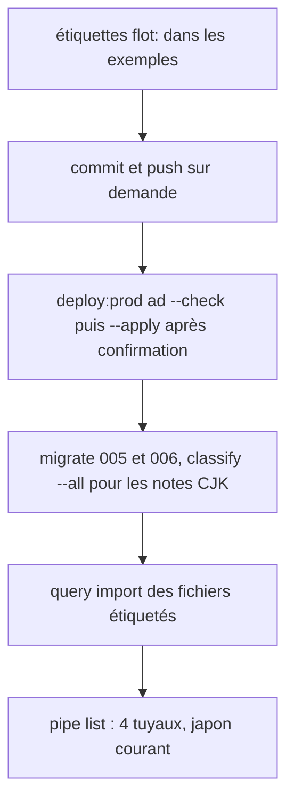
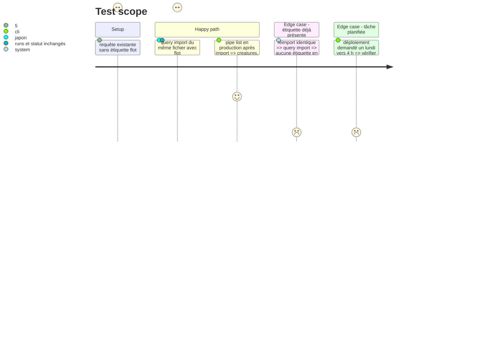

<!-- Fill or omit these sections; never add, rename, or reorder one. -->

# Instruction: Étiquettes `flot:`, documentation et mise en production

## Architecture projection

> Tree of the final files. ✅ create · ✏️ modify · ❌ delete

```txt
.
├── src/explore/index.js                       ✏️ query import ajoute les étiquettes manquantes aux requêtes existantes (aujourd'hui ON CONFLICT DO NOTHING)
├── examples/creatures/queries.json            ✏️ flot:creatures
├── examples/japon/queries.json                ✏️ flot:japon
├── examples/psychologie-2025/queries.json     ✏️ flot:psychologie-2025
├── examples/saint-petersbourg/queries.json    ✏️ flot:saint-petersbourg
├── test/integration/explore.test.js           ✏️ réimport : étiquettes fusionnées, statut et compteurs inchangés
└── README.md                                  ✏️ tuyaux, étiquette flot:, variables WEBPOOL_PIPE_*, pipe list

Serveur (hors dépôt)
└── ~/www/webpool-data/queries/*.json          ✏️ mêmes étiquettes, réimportées
```

## User Journey



## Test Scope



## Tasks to do

### `1)` Import et étiquettes

> Les requêtes de production existent déjà : l'import doit pouvoir les étiqueter.

1. `ON CONFLICT (provider, query) DO UPDATE SET tags` = union sans doublon, rien d'autre ; le résumé d'import distingue ajoutées et mises à jour.
2. Ajouter `flot:<exemple>` à chaque requête des quatre fichiers d'exemple.

### `2)` Documentation

> Le README explique comment l'exploration choisit ce qu'elle lance.

1. Section sur les tuyaux : étiquette, pression, bascule, rotation, tuyau `defaut`, `pipe list`, variables `WEBPOOL_PIPE_*`.

### `3)` Production

> Rien ne part sans demande explicite de l'utilisateur.

1. Commit et push sur demande ; `pnpm deploy:prod ad --check`, puis `--apply` après confirmation, hors passage de la tâche #37068.
2. En ssh : `classify --all` (peut changer des thèmes, donc des pools, par la reconnaissance des mots-clés CJK de la phase 1 ; relever `pool list` avant et après), copie des fichiers étiquetés dans `~/www/webpool-data/queries/`, `query import`, `pipe list`.

## Test acceptance criteria

| Task | Acceptance criteria |
| ---- | ------------------- |
| 1 | Réimporter un fichier étiqueté sur une base qui contient déjà ses requêtes ajoute les étiquettes sans changer `runs`, `status` ni `next_page`. |
| 2 | Le README décrit l'étiquette `flot:`, la bascule et les trois variables avec leurs valeurs par défaut. |
| 3 | En production, `pipe list` montre les quatre tuyaux ; le passage planifié suivant appelle d'abord les requêtes du tuyau courant, puis celles du suivant seulement si le courant n'a plus de requête active. |
