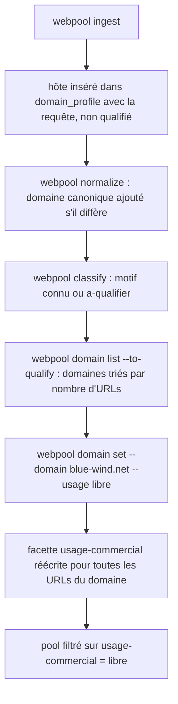
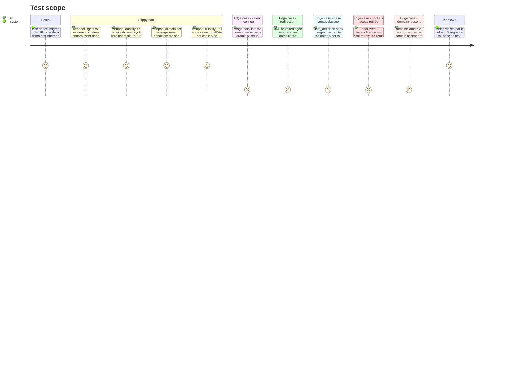

<!-- Fill or omit these sections; never add, rename, or reorder one. -->

# Instruction: Registre des domaines et facette `usage-commercial`

## Architecture projection

> Tree of the final files. ✅ create · ✏️ modify · ❌ delete

```txt
.
├── db/migrations/
│   └── 002_domain_profile.sql        ✅ table domain_profile (domain PK, first_seen_at, first_query, usage_commercial, note, reviewed_at, explore_excluded)
├── config/taxonomy.json              ✏️ facette licence remplacée par usage-commercial (libre, sous-conditions, payant, non-commercial, a-qualifier)
├── src/
│   ├── domains/index.js              ✅ listDomains (compte d'URLs, statut, filtre à qualifier), qualifyDomain (registre + réécriture de la facette)
│   ├── ingest/index.js               ✏️ insère l'hôte de chaque résultat dans domain_profile avec first_query (ON CONFLICT DO NOTHING, RETURNING = domaines nouveaux)
│   ├── normalize/index.js            ✏️ insère aussi le domaine canonique (après redirection), ON CONFLICT DO NOTHING
│   ├── pools/index.js                ✏️ pool create et refresh refusent une facette absente de facet_definition
│   └── classify/index.js             ✏️ la valeur qualifiée du registre l'emporte sur les motifs de usage-commercial
├── bin/webpool.js                    ✏️ domain list [--to-qualify] [--limit N] ; domain set --domain d --usage v [--note texte]
├── test/
│   ├── taxonomy.test.js              ✏️ usage-commercial à la place de licence
│   ├── cli.test.js                   ✏️ validation de --usage avant connexion
│   └── integration/pipeline.test.js  ✏️ registre alimenté par ingest puis normalize, qualification qui réécrit la facette
└── examples/lora/pools/dataset-images-libres.json  ✏️ facets.licence devient facets.usage-commercial
```

## User Journey



## Test Scope



## Tasks to do

### `1)` Migration et taxonomie

> Créer le registre et remplacer la facette ambiguë.

1. `002_domain_profile.sql` : `domain TEXT PRIMARY KEY`, `first_seen_at`, `first_query`, `usage_commercial TEXT NULL` avec contrainte CHECK sur les valeurs, `note`, `reviewed_at`, `explore_excluded BOOLEAN NOT NULL DEFAULT false` ; remplissage initial depuis les URLs normalisées existantes, `first_seen_at` et `first_query` repris de la première découverte dans `url_source`.
2. Taxonomie : facette `usage-commercial` reprenant les motifs de `licence` (libre : unsplash, pexels, pixabay, commons.wikimedia.org, photo-ac.com, openverse, cc0, public domain ; payant : shutterstock, gettyimages, istockphoto, stock.adobe.com, alamy, dreamstime, depositphotos, pixtastock), repli `a-qualifier`. « creative commons » passe en `sous-conditions` (BY, BY-SA).

### `2)` Alimentation et priorité du registre

> Le registre connaît chaque domaine normalisé et l'emporte à la classification.

1. Ingestion : insertion du domaine de chaque résultat, `domainOf(canonicalizeUrl(url))` sans réseau (une URL invalide ou non http est simplement ignorée par le registre, comme aujourd'hui par la normalisation), avec `first_query`, dans la transaction du lot ; `RETURNING` donne les domaines nouveaux, réutilisés par la phase 2.
2. Normalisation : insertion du domaine canonique quand une redirection change d'hôte.
3. Classification : charger les qualifications des domaines du lot et surcharger `facets['usage-commercial']`.

### `3)` Commandes `domain`

> Lister ce qui reste à qualifier, qualifier en une commande.

1. `domain list` : domaine, nombre d'URLs normalisées (les URLs en attente n'ont pas encore de domaine en base), statut, première vue et première requête ; `--to-qualify` filtre `usage_commercial IS NULL`.
2. `domain set` : valide la valeur, met à jour le registre et réécrit `url_facet_value` des URLs classées du domaine, en une transaction ; si la facette n'existe pas encore en base, seul le registre est écrit et la commande le dit.
3. `pool create` et `pool refresh` : refuser une clé de `facets` absente de `facet_definition`, pour qu'un pool sur l'ancienne facette `licence` échoue au lieu de se vider.

## Test acceptance criteria

| Task | Acceptance criteria |
| ---- | ------------------- |
| 1 | `webpool migrate` applique 002 sur une base existante ; les domaines déjà présents sont dans le registre. |
| 1 | Plus aucune référence à la facette `licence` dans le code, les tests et les exemples. |
| 2 | Un domaine vu par deux requêtes du même run n'est nouveau qu'une fois, et garde la première requête. |
| 2 | Un domaine qualifié garde sa valeur après `classify --all`, même si un motif dit autre chose. |
| 3 | `domain set` change la facette des URLs du domaine sans relancer `classify` ; une valeur invalide est refusée avant connexion. |
| 3 | Un pool qui filtre sur une facette inconnue échoue avec un message qui la nomme. |
