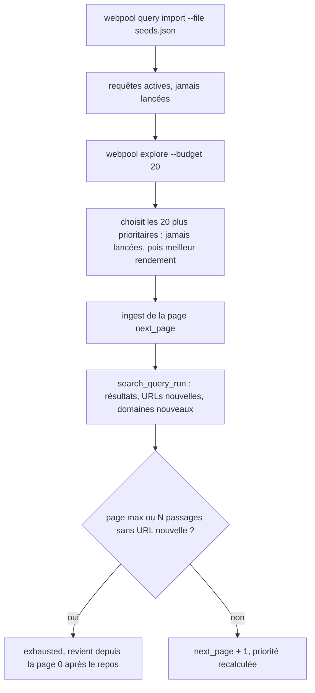
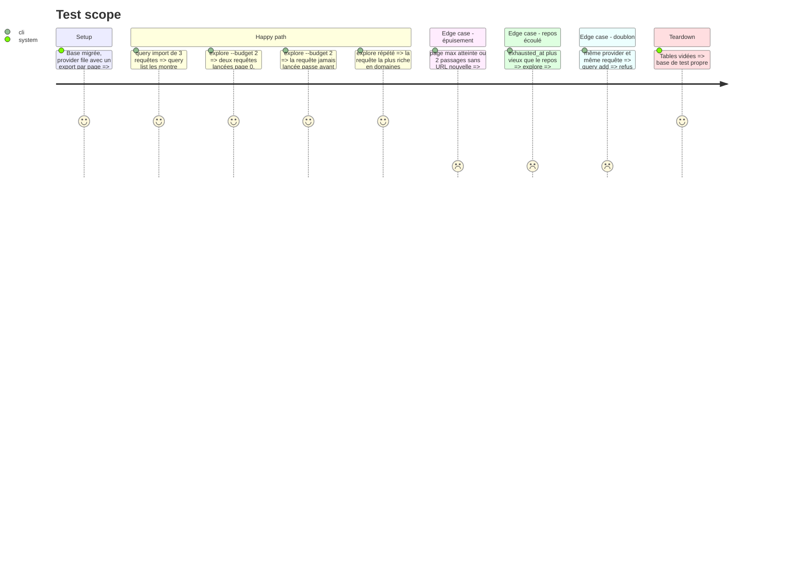

<!-- Fill or omit these sections; never add, rename, or reorder one. -->

# Instruction: Frontière de requêtes, pagination et commande `explore`

## Architecture projection

> Tree of the final files. ✅ create · ✏️ modify · ❌ delete

```txt
.
├── db/migrations/
│   └── 003_search_query.sql          ✅ search_query (provider, query, tags, status, next_page, runs, last_run_at, exhausted_at, origin) + search_query_run (rendement par passage) ; processing_run accepte le type explore
├── src/
│   ├── explore/
│   │   ├── frontier.js               ✅ fonctions pures : priorité, page suivante, épuisement, retour après repos
│   │   └── index.js                  ✅ addQueries, importQueries, listQueries, explore
│   ├── ingest/index.js               ✏️ accepte page, renvoie newDomains (les lignes insérées au registre par la phase 1)
│   ├── ingest/providers/brave.js     ✏️ offset = page (0 à 9)
│   ├── ingest/providers/searxng.js   ✏️ pageno = page + 1
│   ├── ingest/providers/flickr.js    ✏️ page = page + 1
│   ├── ingest/providers/europeana.js ✏️ start = page × rows + 1
│   └── config.js                     ✏️ WEBPOOL_EXPLORE_REST_DAYS (30), WEBPOOL_EXPLORE_DRY_RUNS (2)
├── bin/webpool.js                    ✏️ query add, query import, query list, explore --budget N [--provider p]
└── test/
    ├── frontier.test.js              ✅ priorité, épuisement, repos, ordre des requêtes jamais lancées
    ├── providers.test.js             ✏️ paramètre de page de chaque provider
    └── integration/explore.test.js   ✅ explore sur provider file : rendement enregistré, page avancée, épuisement
```

## User Journey



## Test Scope



## Tasks to do

### `1)` Schéma et fonctions pures

> La frontière se décide sans base.

1. Migration 003 ; élargir le CHECK de `processing_run.kind` à `explore` ; `UNIQUE (provider, query)` ; `tags TEXT[]` (par exemple `lieu:nagasaki`, `lang:ja`) ; `origin` seed ou generated.
2. `frontier.js` : priorité calculée à la sélection depuis `search_query_run`, jamais stockée = moyenne amortie des domaines nouveaux par passage ; requête jamais lancée = priorité maximale ; page max par provider (Brave : 9) ; épuisement ; repos.

### `2)` Pagination des providers et rendement à l'ingestion

> Chaque provider sait aller à la page n ; l'ingestion compte les domaines nouveaux.

1. Paramètre `page` dans `search()` de chaque provider, défaut 0, comportement actuel inchangé ; le provider file l'ignore.
2. Ingestion : `newDomains` = nombre de lignes insérées dans `domain_profile` par le lot (phase 1) ; exact même entre deux requêtes d'un même run, sans attendre la normalisation.

### `3)` Commandes

> Alimenter, lire et lancer la frontière.

1. `query add --provider p --query q [--tags a,b]`, `query import --file f` (JSON : liste de provider, query, tags), `query list [--status s]`.
2. `explore --budget N` : un run `explore`, une ligne par requête (page, résultats, URLs nouvelles, domaines nouveaux), pause d'une seconde entre deux appels Brave.

## Test acceptance criteria

| Task | Acceptance criteria |
| ---- | ------------------- |
| 1 | Pour un historique de passages donné, la priorité et l'état sont déterministes et testés sans base. |
| 2 | Brave reçoit `offset=n` ; un appel sans page garde le comportement actuel. |
| 2 | Un domaine nouveau compte une seule fois par passage, même présent sur plusieurs résultats. |
| 3 | `explore --budget N` n'appelle jamais un provider plus de N fois. |
| 3 | Une requête épuisée n'est plus choisie avant la fin de son repos. |
