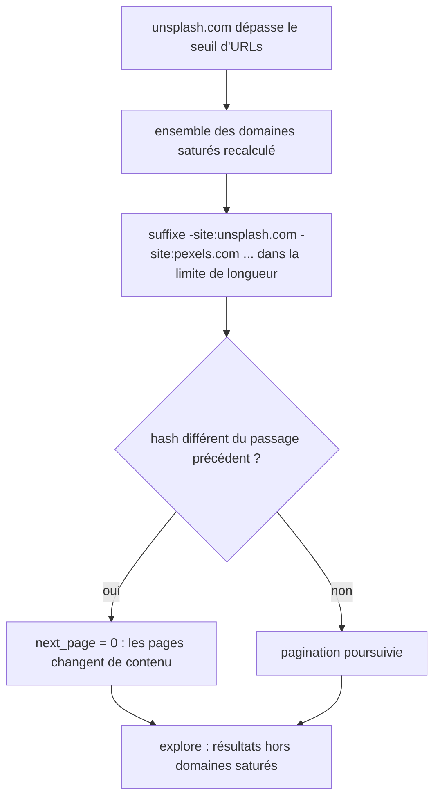
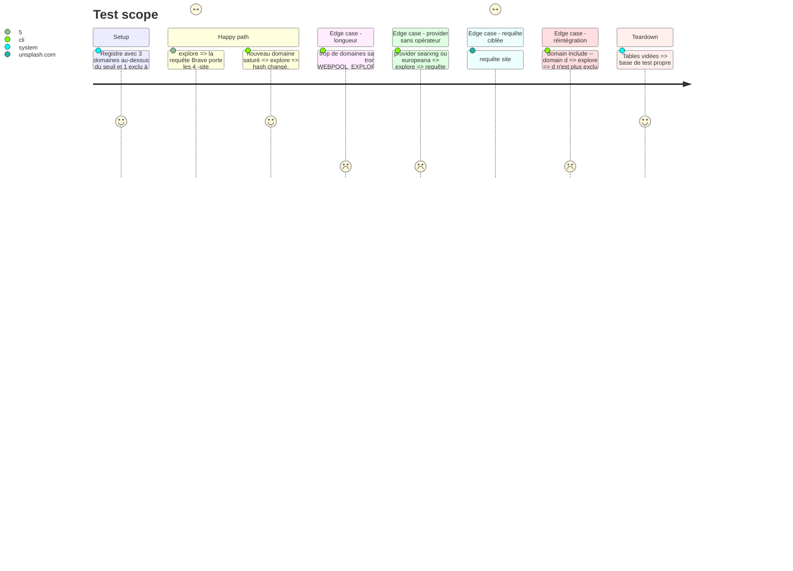

<!-- Fill or omit these sections; never add, rename, or reorder one. -->

# Instruction: Exclusion des domaines saturés

## Architecture projection

> Tree of the final files. ✅ create · ✏️ modify · ❌ delete

```txt
.
├── db/migrations/
│   └── 004_query_exclusion.sql      ✅ search_query.exclusion_hash
├── src/
│   ├── explore/exclusion.js         ✅ fonctions pures : domaines saturés, suffixe -site: borné en longueur, hash de l'ensemble
│   ├── explore/index.js             ✏️ suffixe appliqué aux requêtes Brave ; hash changé => next_page remis à 0
│   ├── domains/index.js             ✏️ domain exclude / include (drapeau explore_excluded)
│   └── config.js                    ✏️ WEBPOOL_EXPLORE_SATURATION (50 URLs), WEBPOOL_EXPLORE_QUERY_MAX_CHARS (400)
├── bin/webpool.js                   ✏️ domain exclude --domain d, domain include --domain d
└── test/
    ├── exclusion.test.js            ✅ sélection, ordre, troncature, hash stable
    └── integration/explore.test.js  ✏️ remise à zéro de la pagination quand l'exclusion change
```

## User Journey



## Test Scope



## Tasks to do

### `1)` Vérification empirique de `-site:`

> Le support n'est pas documenté par Brave : le mesurer avant d'en dépendre.

1. Script jetable dans la scratchpad, exécuté depuis le serveur : même requête avec et sans `-site:unsplash.com -site:pexels.com`, puis comparer les domaines renvoyés.
2. Consigner le résultat dans la section Resources du plan ; si l'opérateur est ignoré, réduire la phase au drapeau d'exclusion et au filtrage à l'ingestion.

### `2)` Fonctions pures d'exclusion

> Choisir quoi exclure et rester sous la longueur sûre.

1. Domaines saturés = nombre d'URLs au-dessus du seuil, ou `explore_excluded` ; triés par nombre d'URLs décroissant.
2. Suffixe borné, calculé par requête (les `site:` présents en sont retirés) ; hash SHA-1 de la liste retenue.

### `3)` Branchement dans `explore` et commandes

> Appliquer l'exclusion aux seuls providers qui la comprennent.

1. Seul Brave reçoit le suffixe (searxng dépend de ses moteurs, non vérifié) ; un domaine visé par un `site:` de la requête n'est jamais exclu.
2. Hash différent de `exclusion_hash` : remise de `next_page` à 0 et du compteur de passages vides.
3. `domain exclude` et `domain include`.

## Test acceptance criteria

| Task | Acceptance criteria |
| ---- | ------------------- |
| 1 | Le résultat de l'essai (opérateur respecté ou non) est écrit dans le plan avant toute implémentation. |
| 2 | La requête finale ne dépasse jamais la longueur configurée, la requête d'origine restant intacte. |
| 3 | Un changement de l'ensemble exclu remet la pagination à 0 ; un ensemble inchangé ne la touche pas. |
