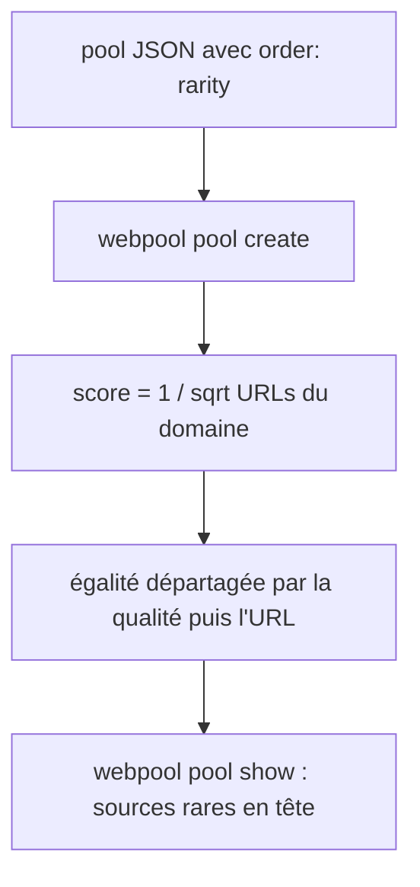
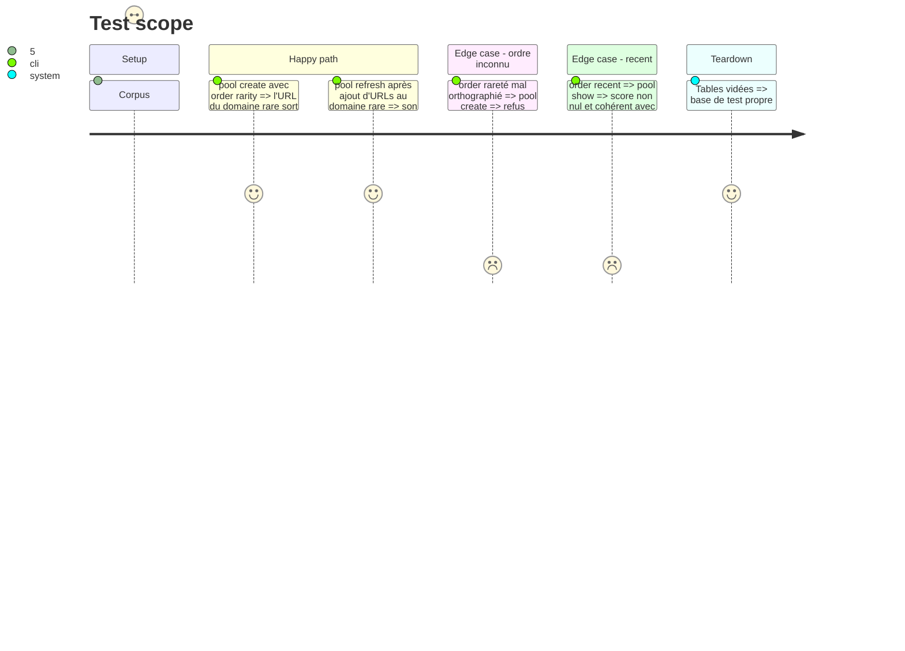

<!-- Fill or omit these sections; never add, rename, or reorder one. -->

# Instruction: Ordre `rarity` dans les pools

## Architecture projection

> Tree of the final files. ✅ create · ✏️ modify · ❌ delete

```txt
.
├── src/pools/criteria.js            ✏️ ORDERS gagne rarity ; jointure agrégée du nombre d'URLs vivantes par domaine ; SCORE_EXPR rarity = 1 / sqrt(ce nombre) ; recent expose un score lisible
├── README.md                        ✏️ ordre rarity documenté
└── test/
    ├── criteria.test.js             ✏️ validation de order: rarity
    └── integration/pipeline.test.js ✏️ pool rarity : domaine rare avant domaine massif
```

## User Journey



## Test Scope



## Tasks to do

### `1)` Ordre `rarity`

> Faire remonter les domaines peu représentés dans le corpus.

1. Ajouter `rarity` à `ORDERS` et à la validation des critères.
2. Expression SQL : une seule jointure `LEFT JOIN (SELECT domain, count(*) … WHERE status <> 'duplicate' GROUP BY domain)`, ajoutée seulement pour cet ordre ; `1 / sqrt(count)` ; départage par qualité puis URL pour un ordre stable.

### `2)` Score de l'ordre `recent`

> Le score affiché vaut toujours 0 aujourd'hui.

1. Exposer un score décroissant avec l'âge (par exemple `1 / (1 + jours depuis first_seen)`), sans changer l'ordre actuel.

## Test acceptance criteria

| Task | Acceptance criteria |
| ---- | ------------------- |
| 1 | Dans un pool `rarity`, une URL d'un domaine à 1 URL précède toute URL d'un domaine à 10 URLs. |
| 1 | Deux exécutions de `pool refresh` sur le même corpus donnent le même ordre. |
| 2 | L'ordre `recent` est inchangé et son score n'est plus constant. |
