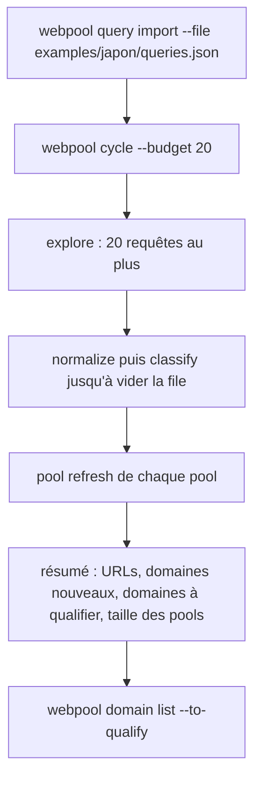
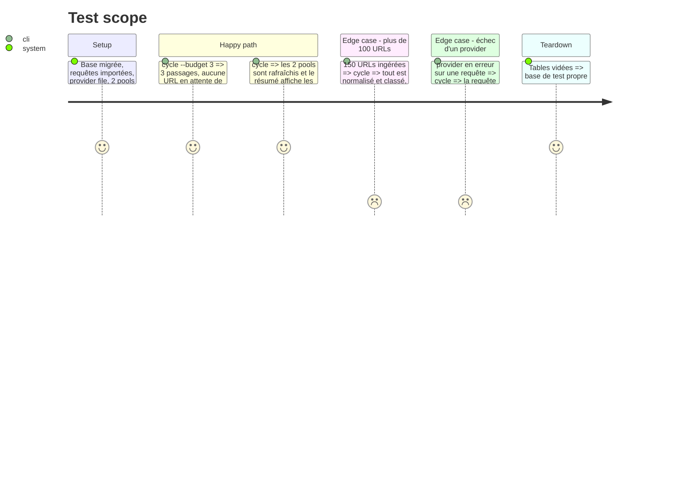

<!-- Fill or omit these sections; never add, rename, or reorder one. -->

# Instruction: Commande `cycle`, requêtes de départ, documentation

## Architecture projection

> Tree of the final files. ✅ create · ✏️ modify · ❌ delete

```txt
.
├── src/cycle/index.js               ✅ explore, puis normalize et classify par lots jusqu'à épuisement, puis refresh de tous les pools
├── bin/webpool.js                   ✏️ cycle --budget N [--provider p] [--offline]
├── examples/japon/
│   ├── queries.json                 ✅ requêtes de départ ja, en, fr pour Nagasaki, Gotō, Tokyo, Kyoto (photos, archives, banques japonaises)
│   └── pools/                       ✅ pools par lieu : tout usage, usage commercial libre, ordre rarity
├── README.md                        ✏️ boucle d'exploration : frontière, registre, exclusion, rarity, cycle
└── test/integration/cycle.test.js   ✅ cycle sur provider file : corpus classé, pools rafraîchis, résumé
```

## User Journey



## Test Scope



## Tasks to do

### `1)` Commande `cycle`

> Une seule commande pour la tâche planifiée.

1. Enchaîner explore, normalize et classify en boucle de lots, puis refresh des pools ; un code de sortie non nul si une étape échoue entièrement.
2. Résumé final sur une ligne par étape, lisible dans les journaux de la tâche planifiée.

### `2)` Requêtes de départ et pools d'exemple

> Reprendre l'essai réel : le japonais et les archives font sortir des sources rares.

1. Requêtes ja (`長崎 写真 フリー素材`, `五島列島 写真`, `京都 写真素材`, `東京 風景 写真`…), en (archives, public domain), fr ; tags `lieu:*` et `lang:*`.
2. Pools par lieu en ordre `rarity`, dont une variante `usage-commercial = libre`.

### `3)` Documentation

> Le README décrit la boucle et ses réglages.

1. Section exploration : commandes, variables `WEBPOOL_EXPLORE_*`, limites (quota Brave, `-site:` selon le résultat de la phase 3).

## Test acceptance criteria

| Task | Acceptance criteria |
| ---- | ------------------- |
| 1 | Après `cycle`, aucune URL ne reste en attente de normalisation ni de classification, même au-delà de 100. |
| 1 | Une erreur de provider sur une requête n'arrête pas le cycle et apparaît dans le résumé. |
| 2 | `query import` des requêtes d'exemple réussit et `query list` les montre avec leurs tags. |
| 3 | Chaque commande et variable ajoutée par les phases 1 à 5 est décrite dans le README. |
