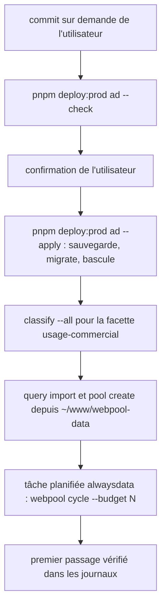
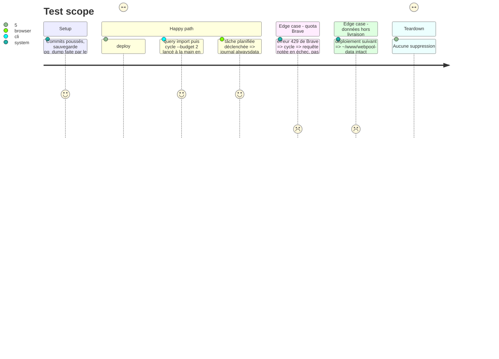

<!-- Fill or omit these sections; never add, rename, or reorder one. -->

# Instruction: Mise en production et tâche planifiée

## Architecture projection

> Tree of the final files. ✅ create · ✏️ modify · ❌ delete

```txt
.
├── deploy/contract.json             ✏️ tâche planifiée décrite (commande, fréquence) ; rien sur les migrations, déjà couvertes par deploy:schema
└── README.md                        ✏️ exploitation : tâche planifiée alwaysdata, fichiers de données hors du répertoire livré

Serveur (hors dépôt)
├── ~/www/webpool                    ✏️ code livré par pnpm deploy:prod ad --apply
└── ~/www/webpool-data/
    ├── queries/japon.json           ✅ requêtes de départ
    └── pools/*.json                 ✅ définitions des pools
```

## User Journey



## Test Scope



## Tasks to do

### `1)` Livraison

> Rien ne part sans demande explicite de l'utilisateur.

1. Commit des phases 1 à 5 sur demande, puis `pnpm deploy:prod ad --check`.
2. Après confirmation : `pnpm deploy:prod ad --apply`, puis `webpool classify --all` en ssh.

### `2)` Données de production

> Les requêtes et les pools vivent hors du répertoire remplacé à chaque livraison.

1. Copier requêtes et pools dans `~/www/webpool-data/`, puis `query import` et `pool create`.
2. Un `cycle --budget 2` manuel pour valider avant la planification ; mesurer sa durée, la limite de durée d'une tâche planifiée alwaysdata n'étant pas connue, pour en déduire le budget.

### `3)` Tâche planifiée

> Dans l'admin alwaysdata (Avancé, Tâches planifiées), via Chrome.

1. Commande : `cd ~/www/webpool && NODEJS_VERSION=24 node bin/webpool.js cycle --budget N` ; fréquence et budget fixés avec l'utilisateur selon le quota Brave (hebdomadaire proposé).
2. Vérifier le premier passage dans les journaux de la tâche.

## Test acceptance criteria

| Task | Acceptance criteria |
| ---- | ------------------- |
| 1 | `webpool stats` répond en production après migration ; une sauvegarde datée existe dans `~/deploy/webpool-ad/backups`. |
| 2 | `query list` en production montre les requêtes de départ ; les pools existent. |
| 3 | Un passage de la tâche planifiée produit un résumé de cycle sans erreur dans les journaux alwaysdata. |
